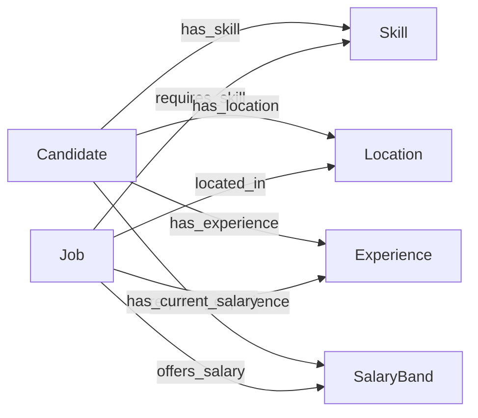

# Phương án nghiên cứu GNN cho hệ gợi ý việc làm

> **Cập nhật 09/11/2026:** Kế hoạch code từ đầu hiện hành nằm trong [KE_HOACH_TRIEN_KHAI_TU_DAU.md](KE_HOACH_TRIEN_KHAI_TU_DAU.md), dựa trên kiểm kê CSV thực tế trong `data/`. Tài liệu này giữ làm bản tham khảo cũ; khi khác nhau về dataset version, môi trường hoặc protocol, dùng kế hoạch mới. Đặc biệt chưa xác nhận CSV cục bộ là JTH v1.1.

**Nhóm phụ trách:** Huy + Phúc  
**Mục tiêu:** Xây dựng hệ gợi ý việc làm Top-20 có xét kỹ năng, ngành, kinh nghiệm, địa điểm, lương và học vấn; giảm các gợi ý không khả thi và cải thiện chất lượng xếp hạng.  
**Dữ liệu chính:** JTH v1.1 (Job Tracking History).  
**Môi trường dự kiến:** Google Colab, Python, PyTorch, PyTorch Geometric.

> Tài liệu này là thiết kế nghiên cứu. Các kết luận về hiệu quả chỉ được xác nhận sau khi có dữ liệu, giao thức đánh giá và kết quả thực nghiệm. “GraphSafe” chưa được xác định là tên một thuật toán GNN chuẩn; trong đề tài này nên hiểu là **GraphSAGE kết hợp cơ chế an toàn/ràng buộc**, hoặc đổi tên thành **Safe-HeteroSAGE** để tránh nhầm lẫn.

### Phạm vi mô hình được chốt

Nhóm chỉ triển khai ba GNN chính trên cùng một pipeline:

| Mô hình | Mục đích |
|---|---|
| GraphSAGE | Đo khả năng học biểu diễn từ lân cận và hỗ trợ nút mới |
| R-GCN | Đo lợi ích của phép biến đổi riêng theo loại quan hệ |
| HGT | Đo lợi ích của attention theo loại nút và loại quan hệ |

Sau khi so sánh trên validation, chọn **một mô hình tốt nhất** để phát triển lần lượt: trọng số quan hệ cố định, trọng số học được toàn cục, trọng số động theo ứng viên, và trọng số động kết hợp re-ranking. Ba mô hình phải dùng cùng dữ liệu đầu vào, temporal split, candidate set, negative-sampling protocol, seed và metric. LightGCN cùng các mô hình phi GNN chỉ đóng vai trò baseline, không tính vào ba mô hình nghiên cứu chính.

## 1. Đặt vấn đề

Trong hệ gợi ý việc làm, điểm phân loại nhị phân cao không bảo đảm danh sách Top-K tốt. Mô hình có thể phân biệt cặp phù hợp/không phù hợp ở mức tổng quát nhưng vẫn xếp một việc không khả thi vào vị trí cao. Nguyên nhân cần kiểm chứng gồm:

- Đồ thị hiện tại chỉ biểu diễn quan hệ **Kỹ năng ↔ Ngành**, bỏ qua kinh nghiệm, địa điểm, lương và học vấn.
- Hàm mất mát phân loại (BCE) không tối ưu trực tiếp thứ tự trong Top-K.
- Mẫu âm, cách chia train/validation/test hoặc rò rỉ cạnh có thể làm chỉ số phân loại lạc quan.
- Mô hình thiếu cơ chế phân biệt điều kiện bắt buộc với sở thích mềm.
- Dữ liệu tương tác ngầm có thiên lệch hiển thị: chưa tương tác không đồng nghĩa không phù hợp.

Ví dụ lỗi nghiệp vụ:

- Gợi ý việc onsite tại Hà Nội cho ứng viên chỉ chấp nhận TP.HCM.
- Gợi ý vị trí yêu cầu tối thiểu 5 năm kinh nghiệm cho ứng viên mới ra trường.
- Gợi ý mức lương tối đa thấp hơn ngưỡng tối thiểu bắt buộc của ứng viên.

### Câu hỏi nghiên cứu

1. Bổ sung bốn nhóm thông tin mới có cải thiện Recall@20, NDCG@20 và MRR@20 không?
2. Trọng số quan hệ động có tốt hơn trọng số cố định khi ứng viên có ưu tiên khác nhau không?
3. Bộ lọc ràng buộc và reranker cải thiện tính khả thi mà không làm giảm quá mức độ phủ hay Recall@20 không?
4. Heterogeneous GraphSAGE có hiệu quả hơn các baseline phi đồ thị và LightGCN trong cùng giao thức không?

### Giả thuyết

- **H1:** Đồ thị mở rộng giúp tăng chỉ số xếp hạng so với đồ thị chỉ có kỹ năng–ngành.
- **H2:** Trọng số động giúp tăng NDCG@20 khi có dữ liệu ưu tiên đáng tin cậy.
- **H3:** Bộ lọc cứng làm giảm ViolationRate@20 mà vẫn duy trì Recall@20 chấp nhận được.
- **H4:** Reranker đa tiêu chí cải thiện thứ tự Top-20 so với chỉ dùng điểm GNN.

## 2. Cơ sở lý thuyết

### 2.1. GNN và message passing

Với nút \(v\), một lớp GNN tổng quát gồm hai bước:

```text
m_v^(l) = AGGREGATE_l({h_u^(l-1) : u thuộc N(v)})
h_v^(l) = UPDATE_l(h_v^(l-1), m_v^(l))
```

Sau \(L\) lớp, biểu diễn của một nút chứa thông tin trong lân cận tối đa \(L\) bước. Bài toán gợi ý được đưa về dự đoán liên kết hoặc xếp hạng cặp Candidate–Job.

### 2.2. So sánh các họ GNN

| Mô hình | Cơ chế | Điểm mạnh | Hạn chế | Vai trò trong đề tài |
|---|---|---|---|---|
| GCN | Trung bình láng giềng đã chuẩn hóa | Đơn giản, mốc GNN tốt | Thường mang tính transductive, không phân biệt quan hệ | Baseline GNN đồng nhất |
| GraphSAGE | Lấy mẫu và tổng hợp láng giềng | Inductive, phù hợp ứng viên/việc mới, kiểm soát chi phí | Cần chọn fan-out; mean aggregator chưa tự phân biệt tầm quan trọng | **Mô hình chính** |
| GAT | Attention theo cạnh/láng giềng | Học trọng số cục bộ | Tốn bộ nhớ/tính toán; attention không tự là lời giải thích nhân quả | Đối chứng mở rộng |
| GGNN/Recurrent GNN | Cập nhật trạng thái bằng GRU | Mô hình hóa truyền tin nhiều bước | Chậm hơn, dễ khó huấn luyện, không cần thiết nếu đồ thị tĩnh | Không ưu tiên ban đầu |
| STGNN | Kết hợp cấu trúc và thời gian | Hợp với đồ thị biến đổi, chuỗi tương tác | Cần timestamp và mục tiêu thời gian rõ ràng | Chỉ dùng khi dữ liệu thời gian đủ tốt |
| R-GCN | Ma trận biến đổi riêng theo quan hệ | Tự nhiên cho đồ thị đa quan hệ | Số tham số tăng theo số quan hệ | Baseline heterogeneous |
| HGT/Heterogeneous GNN | Attention/biến đổi theo loại nút và cạnh | Biểu diễn giàu cho đồ thị không đồng nhất | Phức tạp, nặng hơn trên Colab | Mở rộng nếu đủ tài nguyên |
| LightGCN | Lan truyền tuyến tính trên đồ thị user–item | Baseline mạnh cho collaborative filtering | Không tận dụng side features trực tiếp như thiết kế hetero | Baseline đồ thị gợi ý |

**Lựa chọn triển khai:** GraphSAGE là mô hình làm trước để kiểm tra pipeline; R-GCN và HGT được huấn luyện sau trên đúng dữ liệu đó. Mô hình thắng được chọn theo NDCG@20, Recall@20 và chi phí tính toán trên validation, không mặc định GraphSAGE hoặc HGT tốt nhất.

### 2.3. Trọng số động và ràng buộc cứng

Hai khái niệm phải tách riêng:

- **Trọng số động:** thay đổi mức đóng góp của từng quan hệ theo hồ sơ/hành vi. Ưu tiên chủ động như “gần nhà” chỉ được dùng trong thí nghiệm mô phỏng vì JTH không quan sát sở thích này.
- **Ràng buộc cứng:** loại một việc chắc chắn không hợp lệ; không cho phép điểm kỹ năng cao bù cho yêu cầu kinh nghiệm bắt buộc bị vi phạm.

Với thông điệp theo quan hệ \(m_r(u)\):

```text
alpha(u) = masked_softmax(g(profile_u, behavior_u))
h_u = COMBINE(h_u_self, sum_r alpha_r(u) * m_r(u))
```

Ở phiên bản đầu, `g` có thể là ánh xạ trực tiếp từ trọng số người dùng. Phiên bản sau dùng MLP nhỏ để học hiệu chỉnh nếu có đủ dữ liệu ưu tiên. Quan hệ không có dữ liệu phải được mask trước softmax.

## 3. Dữ liệu

### 3.1. Dữ liệu chính: JTH v1.1

JTH là bộ dữ liệu chính đã chọn. Bản v1.1 gồm dữ liệu tuyển dụng tại Pháp trong giai đoạn 03/2018–04/2025 và được phát hành cho nghiên cứu/giảng dạy phi thương mại theo CC BY-NC 4.0.

| File | Số dòng tham chiếu | Nội dung |
|---|---:|---|
| `candidates.csv` | 37.554 | Hồ sơ tĩnh của ứng viên |
| `jobs.csv` | 6.011 | Hồ sơ tĩnh của vị trí tuyển dụng |
| `history.csv` | 42.288 | Tiến trình Candidate–Job gồm nhiều giai đoạn có timestamp |

- Dữ liệu: [Zenodo record 21390581](https://zenodo.org/records/21390581).
- Mã nguồn, schema và baseline chính thức: [Aunsiels/JTH](https://github.com/Aunsiels/JTH).
- Trước khi xử lý, ghi lại version, checksum, giấy phép và ngày tải.
- Chạy lại splitter/baseline chính thức trước khi thiết kế split riêng để có mốc tái lập.

MEDAJob và notebook RECSYS của giảng viên được giữ làm nguồn đối chiếu nếu nhóm nhận được file và giấy phép phù hợp; không còn là điều kiện chặn để bắt đầu nghiên cứu.

### 3.2. Bộ dữ liệu chuẩn đề xuất

| Bộ dữ liệu | Thành phần chính | Phù hợp | Lưu ý |
|---|---|---|---|
| XING RecSys Challenge 2016 | Hồ sơ người dùng, tin việc, impression, click/bookmark/reply/delete, timestamp | Đánh giá job recommendation và temporal split | Dữ liệu bán tổng hợp, có nhiễu ẩn danh; tải có thể cần chấp nhận điều khoản |
| CareerBuilder Job Recommendation | Người dùng, lịch sử làm việc, tin tuyển dụng, đơn ứng tuyển theo cửa sổ thời gian | Baseline ứng tuyển và đánh giá temporal | Dung lượng khoảng 1.66 GB; chịu quy định cuộc thi Kaggle |
| MovieLens | User–item interaction | Kiểm thử pipeline LightGCN/BPR nhanh | Không có ngữ nghĩa việc làm; không dùng để kết luận nghiệp vụ |

Nguồn ưu tiên là XING vì có thuộc tính nghề nghiệp và tương tác việc làm. CareerBuilder dùng làm bộ kiểm chứng thứ hai nếu tài nguyên cho phép. MovieLens chỉ là sanity check kỹ thuật.

### 3.3. Kiểm kê dữ liệu bắt buộc

Với mỗi bảng/file, báo cáo:

- Số dòng, số cột, kiểu dữ liệu, khóa chính/ngoại.
- Tỷ lệ thiếu, số bản ghi trùng, số giá trị duy nhất.
- Phân phối số tương tác theo ứng viên và việc làm.
- Tỷ lệ cold-start, sparsity và số thành phần liên thông.
- Nguồn nhãn: click, save, apply, expert label hay nhãn sinh bằng quy tắc.
- Khoảng thời gian, tin còn hiệu lực, impression và loại tương tác.

Các trường JTH cần ưu tiên kiểm tra:

- Ứng viên: `candidate_id`, `skills`, `expertise_area`, `job_category`, `years_experience`, `llm_years_of_work_experience`, `llm_highest_diploma`, `zipcode`, `contract_type`, `actual_salary`.
- Việc làm: `job_id`, `skills`, `expertise_area`, `job_category`, `years_experience`, `llm_required_years_of_work_experience`, `llm_required_lowest_diploma`, `zipcode`, `salary`, `contract_type`, `llm_remote_possible`.
- Lịch sử: `candidate_id`, `job_id`, các mốc từ `spontaneous_application_date` đến `job_offer_accepted_date`, `end_of_process_date`, `last_stage_reached`.

### 3.4. Giới hạn và phòng rò rỉ riêng của JTH

- `actual_salary` là lương hiện tại do ứng viên nhập, **không phải lương mong muốn**; không được dùng để tạo ràng buộc “mức lương tối thiểu”.
- `zipcode` chỉ là mã département của Pháp đã làm thô; chỉ dùng `same_zip`/cùng vùng, không tuyên bố khoảng cách đi lại hoặc “gần nhà”.
- JTH không có phúc lợi; không đánh giá lỗi hoặc mức phù hợp về phúc lợi.
- Trường tiền tố `llm_` là dữ liệu suy luận, cần cờ nguồn và ablation riêng; không coi là dữ liệu xác nhận để loại cứng.
- Các trường trong `history.csv` mô tả kết quả tương lai của chính tiến trình tuyển dụng. Chỉ dùng để tạo nhãn/relevance và timestamp; không đưa `shortlist_date`, ngày phỏng vấn, offer hoặc `last_stage_reached` của mẫu đang dự đoán vào đặc trưng đầu vào.
- Các regression/match features được công bố cùng JTH chỉ dùng khi chứng minh chúng có thể tính tại thời điểm gợi ý và chỉ từ dữ liệu train; nếu không, loại khỏi GNN để tránh target/temporal leakage.

### 3.5. Schema chuẩn hóa dự kiến

| Bảng | Trường chính |
|---|---|
| `jobs` | `job_id`, `title`, `description`, `industry_id`, `min_experience`, `salary_min`, `salary_max`, `currency`, `location_id`, `education`, `work_mode` |
| `candidates` | `candidate_id`, `experience`, `current_salary`, `education`, `zipcode`, `contract_type` |
| `skills` | `skill_id`, `canonical_name`, `aliases` |
| `job_skills` | `job_id`, `skill_id`, `required_level`, `mandatory` |
| `candidate_skills` | `candidate_id`, `skill_id`, `level` |
| `candidate_locations` | `candidate_id`, `location_id`, trạng thái nguồn và thiếu dữ liệu |
| `interactions` | `candidate_id`, `job_id`, `action`, `timestamp`, `impressed` |
| `preferences` | `candidate_id`, trọng số theo tiêu chí và trạng thái bắt buộc/mềm |

## 4. EDA, trực quan hóa và tiền xử lý

### 4.1. Danh sách biểu đồ EDA

1. Bar chart tỷ lệ thiếu theo cột.
2. Histogram số năm kinh nghiệm ứng viên và yêu cầu công việc.
3. Histogram/boxplot lương sau chuẩn hóa, tách theo ngành và địa điểm.
4. Bar chart Top-20 kỹ năng, ngành, địa bàn, trình độ.
5. Log-log plot bậc nút cho Candidate, Job và Skill.
6. Heatmap số cạnh theo loại quan hệ.
7. Phân phối số tương tác/người và tương tác/việc.
8. Timeline số tin, impression và tương tác theo ngày/tuần.
9. Sankey hoặc chord chart quy mô nhỏ cho Industry–Skill–Job.
10. Tỷ lệ cold-start và sparsity theo split.
11. Funnel chart từ ứng tuyển → shortlist → phỏng vấn → đề xuất → chấp nhận.
12. So sánh missing rate giữa trường nhập tay và trường `llm_`.

### 4.2. Trực quan hóa đồ thị

- Chỉ lấy subgraph 50–200 nút bằng ego graph hoặc sampling; không vẽ toàn bộ đồ thị lớn.
- Màu theo loại nút, kiểu nét theo loại cạnh, kích thước theo log-degree.
- Dùng NetworkX + PyVis/Plotly cho demo tương tác; dùng matplotlib/seaborn cho báo cáo tĩnh.
- Vẽ riêng một đường dẫn giải thích: Candidate → Skill/Location/Experience → Job.

### 4.3. Tiền xử lý

- Chuẩn hóa kỹ năng và địa danh bằng từ điển bí danh; lưu cả giá trị gốc và chuẩn hóa.
- Chuẩn hóa lương theo tiền tệ và chu kỳ; không biến “thỏa thuận” thành 0 và không đổi lương hiện tại thành lương kỳ vọng.
- Phân cấp học vấn và kinh nghiệm nhưng giữ giá trị số gốc.
- Phân biệt `missing`, `unknown`, `not_required` và giá trị thật.
- Loại trùng tin trước khi chia tập để tránh rò rỉ.
- Chỉ fit encoder/scaler/vocabulary trên phần train.
- Nếu trích xuất từ văn bản bằng regex/từ điển, đánh giá precision/recall trên mẫu gán nhãn thủ công.
- Tách danh sách kỹ năng, lĩnh vực, ngành và hợp đồng theo dấu `;`; không tách sentinel `_rare_skill_` thành kỹ năng thật.
- Lưu `candidates_clean.csv`, `jobs_clean.csv`, `interactions_clean.csv` và `preprocessing_report.csv`.

## 5. Xây dựng đồ thị không đồng nhất

### 5.1. Loại nút

`Candidate`, `Job`, `Skill`, `ExperienceLevel`, `Location`, `SalaryBand`, `EducationLevel`, `Expertise`, `Category`, `Contract`.

`SalaryBand` phía ứng viên biểu diễn **lương hiện tại**, không phải lương kỳ vọng. Salary và Experience được phân nhóm theo các khoảng có ý nghĩa; không tạo một nút riêng cho từng giá trị số.

### 5.2. Loại quan hệ

| Nguồn | Quan hệ | Đích |
|---|---|---|
| Candidate | `has_skill` | Skill |
| Job | `requires_skill` | Skill |
| Candidate | `interested_in` | Industry |
| Job | `belongs_to` | Industry |
| Candidate | `has_experience` | ExperienceLevel |
| Job | `requires_experience` | ExperienceLevel |
| Candidate | `has_location` | Location |
| Job | `located_in` | Location |
| Candidate | `has_current_salary` | SalaryBand |
| Job | `offers_salary` | SalaryBand |
| Candidate | `has_education` | EducationLevel |
| Job | `requires_education` | EducationLevel |
| Candidate | `has_expertise` | Expertise |
| Job | `requires_expertise` | Expertise |
| Candidate | `in_category` | Category |
| Job | `in_category` | Category |
| Candidate | `accepts_contract` | Contract |
| Job | `offers_contract` | Contract |
| Candidate | `applied_to` | Job |

Quan hệ Candidate–Job và mức relevance được suy ra theo giai đoạn tuyển dụng đã chốt. Thêm cạnh ngược khi cần truyền tin hai chiều. Khi giữ lại tương tác cho validation/test, phải loại cả cạnh thuận và cạnh ngược tương ứng khỏi đồ thị train.



## 6. Ba mô hình GNN và kiến trúc cải tiến

### 6.1. Pipeline

```text
Dữ liệu thô
  → chuẩn hóa và temporal split
  → heterogeneous graph
  → GraphSAGE / R-GCN / HGT
  → chọn mô hình tốt nhất trên validation
  → dynamic relation gate
  → Candidate–Job scorer
  → hard-constraint filter
  → multi-criteria reranker
  → Top-20 + lý do
```

### 6.2. Encoder và scorer dùng chung

- GraphSAGE: hai lớp `SAGEConv` theo từng quan hệ qua `HeteroConv`, mean aggregation.
- R-GCN: hai lớp `RGCNConv`, mã hóa `edge_type`; cần ánh xạ đồ thị dị thể sang biểu diễn nút/cạnh phù hợp mà không làm mất loại nút.
- HGT: hai lớp `HGTConv`, attention nhiều head theo metadata của đồ thị.
- Cấu hình đầu tiên dùng hidden dimension `d=64`; số lớp, dropout và head được tuning trên validation trong cùng ngân sách.
- Scorer:

```text
score_gnn(u, j) = MLP([h_u || h_j || h_u ⊙ h_j || |h_u - h_j|])
```

Huấn luyện bằng BCE khi có nhãn nhị phân đáng tin cậy; ưu tiên BPR/pairwise ranking khi chỉ có implicit feedback. Có thể dùng loss kết hợp:

```text
L = L_rank + beta * L_classification + gamma * L2
```

Mỗi mô hình phải xuất loss curve, Recall@20, NDCG@20, MRR@20, tổng/trainable parameters, thời gian train, thời gian inference, peak GPU RAM và kích thước checkpoint.

### 6.3. Cơ chế trọng số sau khi chọn mô hình

Chỉ phát triển trên mô hình thắng validation:

1. **Cố định:** trọng số quan hệ do nhóm đặt làm đối chứng; chỉ là giá trị khởi tạo/minh họa.
2. **Học được toàn cục:** mỗi quan hệ có một tham số chung cho mọi ứng viên.
3. **Động theo ứng viên:** gating network tính trọng số từ embedding, đặc trưng ứng viên và embedding quan hệ.

```text
alpha_(u,r) = softmax_r(MLP([h_u || e_r || x_u]))
h'_u = sum_r alpha_(u,r) * m_(u,r)
```

JTH không có sở thích lương hoặc khoảng cách thực tế. Vì vậy trọng số động được học từ hồ sơ/hành vi; các kịch bản “ưu tiên gần nhà” hoặc “ưu tiên lương” chỉ là mô phỏng sensitivity, không được trình bày như sở thích đã quan sát.

### 6.4. Bộ lọc an toàn

| Tiêu chí | Loại khi |
|---|---|
| Kinh nghiệm | Ứng viên thấp hơn mức tối thiểu được đánh dấu bắt buộc |
| Địa điểm | Việc onsite ngoài vùng chấp nhận và không cho phép chuyển nơi ở |
| Lương | Chưa dùng làm điều kiện loại cứng với JTH vì không có lương kỳ vọng |
| Học vấn | Không đạt yêu cầu bắt buộc theo bảng tương đương đã định nghĩa |

Nếu dữ liệu thiếu hoặc trường yêu cầu chỉ do LLM suy luận, đánh dấu `unknown`/tín hiệu mềm; không tự coi là đạt hoặc vi phạm. Báo cáo riêng UnknownRate@20.

### 6.5. Reranker

Sau bộ lọc, lấy Top-N ứng viên (ví dụ 100) và tính:

```text
final_score = lambda * norm(score_gnn)
            + (1 - lambda) * sum_c w_c * match_c(candidate, job)
```

Các `match_c`: kỹ năng, kinh nghiệm, cùng département, học vấn, ngành, expertise và loại hợp đồng. Lương chỉ là tín hiệu mềm nếu định nghĩa đối sánh được chứng minh phù hợp. Chọn `lambda` và trọng số trên validation. Không cho reranker phục hồi một việc đã vi phạm ràng buộc cứng.

## 7. Baseline và ablation

### 7.1. Baseline phi GNN

1. **Popularity:** việc phổ biến theo toàn cục hoặc theo ngành/địa điểm.
2. **Content cosine:** TF-IDF hoặc embedding hồ sơ–mô tả việc.
3. **Rule-based weighted matching:** tổng điểm kỹ năng, địa điểm, kinh nghiệm, lương, học vấn.
4. **Logistic Regression / MLP:** dự đoán cặp từ đặc trưng đối sánh.
5. **XGBoost/LightGBM ranker:** baseline mạnh cho dữ liệu bảng nếu cài đặt được trên Colab.
6. **Matrix Factorization/BPR-MF:** collaborative filtering từ tương tác.

### 7.2. Baseline đồ thị

1. GCN trên đồ thị đồng nhất.
2. LightGCN trên đồ thị Candidate–Job.
3. Baseline/RecruiterGCN từ mã nguồn JTH nếu tái lập được.

GraphSAGE, R-GCN và HGT là ba mô hình nghiên cứu chính, không xếp lẫn vào baseline.

### 7.3. Ma trận ablation

| Mã | Cấu hình |
|---|---|
| TN1 | GraphSAGE |
| TN2 | R-GCN |
| TN3 | HGT |
| TN4 | GNN tốt nhất + trọng số cố định |
| TN5 | GNN tốt nhất + trọng số học được toàn cục |
| TN6 | GNN tốt nhất + trọng số động theo ứng viên |
| TN7 | TN6 + bộ lọc đủ tin cậy + reranker |

Thêm ablation bỏ lần lượt kỹ năng, kinh nghiệm, địa điểm, lương hiện tại, học vấn, expertise, category, contract, trường `llm_`, trọng số động và reranker. Mọi cấu hình phải dùng cùng split, candidate set, negative sampling, seed và ngân sách tuning.

## 8. Độ phức tạp và số tham số

Ký hiệu: \(|V|\) nút, \(|E|\) cạnh, \(R\) loại quan hệ, \(L\) lớp, \(d\) hidden dimension, \(S_l\) fan-out lớp \(l\), \(B\) số nút/cặp gốc trong batch.

### 8.1. Độ phức tạp gần đúng

| Thành phần | Thời gian | Bộ nhớ/ghi chú |
|---|---|---|
| Full-batch GCN/SAGE | `O(L·(|E|d + |V|d²))` | `O(|V|d + |E|)`; khó với đồ thị lớn |
| Neighbor-sampled SAGE | `O(B·ΠS_l·d²)` gần đúng | Phụ thuộc fan-out, phù hợp Colab hơn |
| GAT | `O(L·(|E|d + |V|d²))` | Cần giữ hệ số attention theo cạnh/head |
| LightGCN | `O(L·|E|d)` | Tham số chính là embedding user/item |
| Hard filter | `O(M)` | `M` số việc được xét |
| Rerank | `O(N·C + N log N)` | `N` shortlist, `C` số tiêu chí |

### 8.2. Công thức số tham số

Không ghi một con số cố định trước khi biết kích thước feature và số loại quan hệ. Script huấn luyện phải in:

```python
total_params = sum(p.numel() for p in model.parameters())
trainable_params = sum(p.numel() for p in model.parameters() if p.requires_grad)
```

Ước lượng một lớp HeteroSAGE với ma trận riêng theo quan hệ, đầu vào `d_in`, đầu ra `d_out`:

```text
P_layer ≈ R * (d_in*d_out + d_out) + T * (d_in*d_out + d_out)
```

Trong đó `T` là số loại nút nếu có phép chiếu self riêng. Dynamic gate MLP từ vector ưu tiên kích thước `q` qua hidden `g` ra `R` trọng số:

```text
P_gate = q*g + g + g*R + R
```

MLP scorer với input `4d`, hidden `s`, output 1:

```text
P_scorer = 4d*s + s + s + 1
```

Báo cáo thêm FLOPs ước lượng, thời gian/epoch, peak GPU RAM, thời gian suy luận mỗi ứng viên và kích thước checkpoint.

## 9. Giao thức huấn luyện trên Colab

### 9.1. Cấu trúc notebook

1. `00_setup.ipynb`: mount Drive, cài phiên bản khóa, seed, kiểm tra GPU.
2. `01_data_audit.ipynb`: schema, khóa, missing, bất thường, timestamp.
3. `02_eda.ipynb`: EDA ứng viên, việc, funnel và đồ thị mẫu.
4. `03_preprocessing.ipynb`: làm sạch, mã hóa, tạo relevance/split.
5. `04_graph_construction.ipynb`: tạo `HeteroData`, thống kê và kiểm tra cạnh.
6. `05_graphsage.ipynb`, `06_rgcn.ipynb`, `07_hgt.ipynb`: ba mô hình chính.
7. `08_model_comparison.ipynb`: chọn mô hình tốt nhất trên validation.
8. `09_dynamic_weights.ipynb`: fixed/global/dynamic weighting.
9. `10_reranking.ipynb`: shortlist Top-100 và rerank Top-20.
10. `11_ablation_evaluation.ipynb`: test cuối, ablation và biểu đồ.

### 9.2. Cấu hình khởi đầu

```yaml
seed: 42
hidden_dim: 64
num_layers: 2
fanouts: [15, 10]
batch_size: 1024
learning_rate: 0.001
weight_decay: 0.00001
dropout: 0.2
max_epochs: 50
early_stopping_patience: 10
negative_samples_per_positive: 5
monitor: ndcg@20
```

Đây là cấu hình thử nghiệm, không phải giá trị tối ưu. Lưu checkpoint, mapping ID, scaler, vocabulary, cấu hình và commit/version dữ liệu. Với Colab, lưu định kỳ lên Drive để tránh mất phiên.

## 10. Đánh giá

### 10.1. Chỉ số chính

- **Recall@20:** tỷ lệ mục liên quan được tìm thấy trong Top-20.
- **NDCG@20:** thưởng cho mục liên quan xuất hiện sớm; là metric chọn checkpoint đề xuất.
- **MRR@20:** nghịch đảo thứ hạng mục liên quan đầu tiên.
- **HitRate@20:** tỷ lệ ứng viên có ít nhất một mục liên quan trong Top-20.
- **Precision@20:** dùng khi tập nhãn dương đủ đầy; diễn giải thận trọng với implicit feedback.

### 10.2. Chỉ số nghiệp vụ và hệ thống

- **ViolationRate@20:** tỷ lệ gợi ý vi phạm điều kiện đã xác định.
- **UnknownRate@20:** tỷ lệ gợi ý không đủ dữ liệu kiểm tra điều kiện.
- **Coverage@20:** tỷ lệ việc/ứng viên được hệ thống bao phủ.
- **Catalog coverage, novelty, diversity:** tránh chỉ gợi ý việc phổ biến và trùng lặp.
- Tỷ lệ trả đủ 20 việc, số kết quả trung bình.
- Latency p50/p95, thời gian train, peak GPU RAM.

### 10.3. Chia dữ liệu và phòng rò rỉ

- Ưu tiên temporal split: train trước, validation sau, test cuối.
- Mốc ban đầu có thể là 70%/10%/20% theo thời gian, nhưng phải đối chiếu splitter chính thức của JTH và điều chỉnh nếu tạo quá nhiều ứng viên/việc không thể đánh giá.
- Không cho tương tác test hoặc cạnh ngược của nó vào đồ thị train.
- Chỉ đánh giá trên việc còn hiệu lực tại thời điểm gợi ý.
- Dùng cùng candidate set giữa các mô hình; ghi rõ full-ranking hay sampled-ranking.
- JTH không cung cấp impression đầy đủ. Trong train có thể lấy khoảng 5 việc chưa quan sát cho mỗi positive, nhưng chỉ từ việc tồn tại tại thời điểm tương tác; đây là unobserved negative, không phải nhãn không phù hợp chắc chắn.
- Validation/test ưu tiên full-ranking trên tập việc hợp lệ; nếu sampled-ranking vì giới hạn tài nguyên, cố định candidate set và báo cáo rõ.
- Chạy ít nhất 3–5 seed khi tài nguyên cho phép; báo cáo mean ± std.

### 10.4. Danh sách biểu đồ kết quả

1. Grouped bar: Recall/NDCG/MRR@20 theo mô hình.
2. Bar: ViolationRate và UnknownRate theo mô hình.
3. Pareto plot: NDCG@20 so với latency hoặc GPU RAM.
4. Ablation waterfall: mức thay đổi khi thêm/bỏ từng nhóm thuộc tính.
5. Line: metric theo `K ∈ {5, 10, 20, 50}`.
6. Line: metric theo epoch, kèm train/validation loss.
7. Box/violin: kết quả theo seed.
8. Heatmap: metric theo `lambda` và trọng số rerank.
9. Slice analysis: theo cold-start, vùng, mức kinh nghiệm, dải lương.
10. Confusion/error taxonomy: sai địa điểm, kinh nghiệm, lương, học vấn.

## 11. Tiêu chí kết luận

Không đặt trước tỷ lệ cải thiện khi chưa có baseline. Hệ thống được xem là tốt hơn khi:

1. NDCG@20 và Recall@20 tăng ổn định qua nhiều seed hoặc ít nhất không giảm đáng kể.
2. ViolationRate@20 giảm rõ rệt.
3. Coverage và tỷ lệ trả đủ 20 không suy giảm quá mức.
4. Latency và bộ nhớ nằm trong giới hạn Colab/demo.
5. Kết quả ablation chứng minh đóng góp của thuộc tính/trọng số động, thay vì chỉ do tuning khác nhau.

“Tăng mức độ hài lòng thực tế” chỉ được kết luận khi có user study, A/B test hoặc đánh giá chuyên gia độc lập. Chỉ số offline không đủ chứng minh trực tiếp mức hài lòng.

## 12. Phân công Huy + Phúc

| Hạng mục | Huy | Phúc | Sản phẩm chung |
|---|---|---|---|
| Dữ liệu, EDA | Hỗ trợ/kiểm tra | Chính | Data dictionary + báo cáo EDA |
| Tiền xử lý, đồ thị | Hỗ trợ/kiểm tra | Chính | Processed data + `graph.pt` |
| GraphSAGE | Kiểm tra | Chính | Model + checkpoint + metric |
| R-GCN, HGT | Chính | Hỗ trợ | Model + checkpoint + metric |
| Dynamic weighting | Chính | Phối hợp | Fixed/global/dynamic experiments |
| Filter, reranker | Chính | Phối hợp | Module + before/after Top-20 |
| Đánh giá, ablation | Cùng làm | Cùng làm | Bảng, biểu đồ, báo cáo |

Hai thành viên cùng review code, chạy lại notebook từ đầu và xác nhận kết quả tái lập được.

## 13. Lộ trình bốn tuần

| Tuần | Công việc | Điều kiện hoàn thành |
|---|---|---|
| 1 | Tải JTH; audit, EDA, preprocessing, temporal split, dựng graph | Notebook 01–04 chạy được; processed data và `graph.pt` hợp lệ |
| 2 | GraphSAGE, R-GCN, HGT; checkpoint và đánh giá validation lần đầu | Ba mô hình dùng chung pipeline và có bảng metric/chi phí |
| 3 | Chọn mô hình; fixed/global/dynamic weighting; filter và reranker | TN4–TN7 chạy được, có sensitivity và before/after Top-20 |
| 4 | Test cuối, ablation, đo hiệu năng, biểu đồ, báo cáo và demo | Bộ thực nghiệm tái lập được và sản phẩm bàn giao đầy đủ |

Lịch bốn tuần có rủi ro cao. Nếu thiếu thời gian, ưu tiên dữ liệu đúng, graph đúng và so sánh ba mô hình; HGT tuning sâu, demo giao diện và các metric phụ được xếp sau.

## 14. Cấu trúc thư mục triển khai

```text
GNN_for_RCM/
├── data/
│   ├── raw/
│   ├── processed/
│   └── splits/
├── notebooks/
│   ├── 01_data_audit.ipynb
│   ├── 02_eda.ipynb
│   ├── 03_preprocessing.ipynb
│   ├── 04_graph_construction.ipynb
│   ├── 05_graphsage.ipynb
│   ├── 06_rgcn.ipynb
│   ├── 07_hgt.ipynb
│   ├── 08_model_comparison.ipynb
│   ├── 09_dynamic_weights.ipynb
│   ├── 10_reranking.ipynb
│   └── 11_ablation_evaluation.ipynb
├── models/
│   ├── graphsage.py
│   ├── rgcn.py
│   ├── hgt.py
│   └── dynamic_weighting.py
├── utils/
│   ├── preprocessing.py
│   ├── graph_builder.py
│   ├── negative_sampling.py
│   ├── metrics.py
│   └── visualization.py
├── results/
│   ├── checkpoints/
│   ├── metrics/
│   ├── figures/
│   └── tables/
├── train.py
├── evaluate.py
├── reranking.py
├── requirements.txt
└── README.md
```

Notebook dùng để khám phá và trình bày; logic dùng lại phải chuyển vào `models/` hoặc `utils/` để ba mô hình chạy cùng pipeline.

## 15. Checklist triển khai thực tế

- [ ] 1. Tải đúng JTH v1.1, lưu metadata/checksum/giấy phép.
- [ ] 2. Chạy notebook audit schema, khóa ngoại và missing values.
- [ ] 3. Hoàn thành EDA và xuất 8–12 biểu đồ, gồm recruitment funnel.
- [ ] 4. Làm sạch, chuẩn hóa và lưu các bộ encoder chỉ fit trên train.
- [ ] 5. Định nghĩa positive/relevance mà không dùng thông tin tương lai làm feature.
- [ ] 6. Tạo temporal train/validation/test và negative sampling cho train.
- [ ] 7. Dựng đồ thị dị thể, cạnh ngược và kiểm tra leakage.
- [ ] 8. Huấn luyện GraphSAGE.
- [ ] 9. Huấn luyện R-GCN.
- [ ] 10. Huấn luyện HGT.
- [ ] 11. So sánh ba mô hình trên validation và chọn mô hình thắng.
- [ ] 12. Chạy trọng số cố định, toàn cục và động.
- [ ] 13. Tích hợp filter đủ tin cậy và reranker.
- [ ] 14. Chạy test một lần, ablation và đo hiệu năng.
- [ ] 15. Xuất bảng, biểu đồ, notebook tái lập và báo cáo.

Thứ tự bắt buộc là dữ liệu → EDA → preprocessing → split → graph → ba GNN → trọng số động → reranking. Không bắt đầu từ HGT hoặc dynamic weighting khi notebook 01–04 chưa được xác nhận.

## 16. Sản phẩm bàn giao

| Sản phẩm | Định dạng |
|---|---|
| Dữ liệu đã làm sạch và split | CSV/Parquet |
| Báo cáo audit và EDA | IPYNB + PDF/HTML |
| Đồ thị dị thể và thống kê node/edge | PT + CSV/PNG |
| GraphSAGE, R-GCN, HGT | PY + checkpoint PT |
| Dynamic weighting và reranking | PY |
| Kết quả TN1–TN7 và ablation | CSV/XLSX |
| Biểu đồ đánh giá | PNG/SVG |
| Notebook tổng hợp tái lập | IPYNB |
| Báo cáo nghiên cứu | DOCX/PDF |

## 17. Checklist đầu vào còn thiếu

- [x] Nguồn JTH v1.1, schema, số dòng và giấy phép.
- [ ] Tải ba file JTH và xác nhận checksum thực tế.
- [ ] Chốt định nghĩa positive/relevance từ các giai đoạn tuyển dụng.
- [ ] Chốt giao thức split chính thức hay split 70/10/20 tùy chỉnh.
- [ ] Xác định full-ranking hay sampled-ranking cho test.
- [ ] File hoặc URL MEDAJob nếu cần đối chiếu bổ sung.
- [ ] Source/notebook RECSYS của giảng viên.
- [ ] Quy tắc nghiệp vụ nào đủ tin cậy để dùng làm điều kiện bắt buộc.
- [ ] Giới hạn RAM/GPU và thời hạn nộp.
- [ ] Baseline/metric bắt buộc theo yêu cầu môn học.

## 18. Tài liệu tham khảo chính

1. Hamilton, Ying, Leskovec, [Inductive Representation Learning on Large Graphs (GraphSAGE)](https://proceedings.neurips.cc/paper/2017/hash/5dd9db5e033da9c6fb5ba83c7a7ebea9-Abstract.html), NeurIPS 2017.
2. Kipf, Welling, [Semi-Supervised Classification with Graph Convolutional Networks](https://arxiv.org/abs/1609.02907), ICLR 2017.
3. Veličković et al., [Graph Attention Networks](https://arxiv.org/abs/1710.10903), ICLR 2018.
4. Schlichtkrull et al., [Modeling Relational Data with Graph Convolutional Networks](https://arxiv.org/abs/1703.06103), ESWC 2018.
5. Hu et al., [Heterogeneous Graph Transformer](https://arxiv.org/abs/2003.01332), WWW 2020.
6. He et al., [LightGCN: Simplifying and Powering Graph Convolution Network for Recommendation](https://arxiv.org/abs/2002.02126), SIGIR 2020.
7. Rendle et al., [BPR: Bayesian Personalized Ranking from Implicit Feedback](https://arxiv.org/abs/1205.2618), UAI 2009.
8. Abel et al., [RecSys Challenge 2016: Job Recommendations](https://2016.recsyschallenge.com/pdf/abel_recwk528.pdf), RecSys 2016.
9. [XING RecSys Challenge 2016 — mô tả dữ liệu và baseline](https://github.com/recsyschallenge/2016).
10. [CareerBuilder Job Recommendation Challenge — mô tả dữ liệu](https://www.kaggle.com/competitions/job-recommendation/data).
11. [PyTorch Geometric — Heterogeneous Graph Learning](https://pytorch-geometric.readthedocs.io/en/latest/notes/heterogeneous.html).
12. Romero, Millet, Behar, [JTH v1.1 — Job Tracking History](https://github.com/Aunsiels/JTH), RecSys 2026 artifact.
13. [JTH v1.1 dataset on Zenodo](https://zenodo.org/records/21390581), CC BY-NC 4.0.
